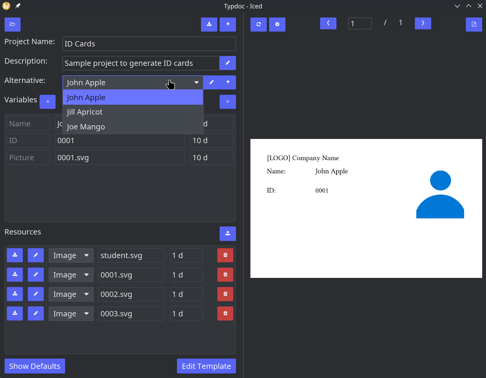

# TypDoc - A Typst based Document format

Intended use: Someone writes a typst document/template with configurable options, and provides the document and this program for someone unfamiliar with typst to customize minimally.

This program makes it easier to share documents in typst with all the resources it needs for compilation while also providing a simple way for people to modify anything they want in that document to regenerate the PDFs. The convenient GUI to modify simple variables set up in the typst template allows someone without the understanding of the typst syntax to customize the document output.

The GUI contains a simple interface to edit variables, add more alternatives the different values for the variables for batch export of different versions of the same document. The screenshot below comes from the `idcards.typdoc` file included in this repository as an example. The document contains a simple typst template with system variables you can edit through the GUI.

# Features
- Edit typst template,
- Instant preview on typst template or variable edits,
- Useful compilation error messages,
- Uniform variables across alternatives,
- Rename variables (use defaults view),
- Rename resources (be careful to not change extensions),
- Rename alternatives

# TODOs
- upload directories as resources (might be complicated)
- keep directory tree as resource
- Import/Export a compilable typst project from/to ZIP file

